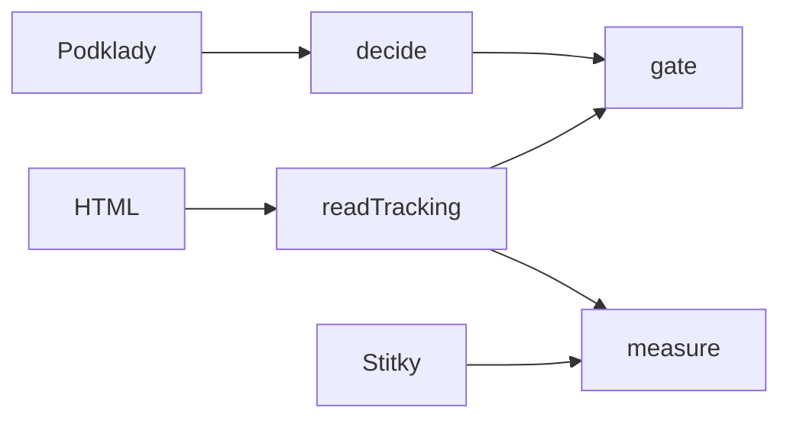

# Reklamace uvízlých zásilek

Řez rozhodne, jestli se k objednávce založí reklamace, a když ne, proč. Kandidáta udělá zastaralý stav v Mailshipu. Pravdu o doručení dá až čerstvá stránka dopravce. Jazykový model v tomhle řezu není: podmínky jsou pevné a stránky mají šablonu. Jedno vyhodnocení stránky stojí 0 Kč.

## Upozornění k podkladům

Skutečný balíček k zadání nepřišel. V `data/` je syntetická náhrada, popsaná v [data/README.md](data/README.md). Stejný příkaz umí cizí adresář:

```
npm run decide -- --data <adresář>
npm run measure -- --data <adresář>
```

Když se jmenují pole jinak, mění se jen `src/pack/load.ts`. Pravidla a brána zůstávají.

## Rychlý start

Node 22 (`nvm use`), pak:

```
npm ci && npm start
```

`npm start` pustí kontrolu typů, testy, tabulku rozhodnutí a měření. Na tomto stroji doběhne za pár sekund. Konec tabulky a měření vypadá takto:

```
FILE 12  NEEDS_HUMAN 7  DO_NOT_FILE 26
pages 64  dev 94.3%  holdout 93.1%  dangerous 0  suppressing 0  abstention 4
```

Podrobná zpráva je [docs/mereni.md](docs/mereni.md). Tam je shoda holdoutu `93.1 %` a dev `94.3 %`.

Jak job rozhoduje na konkrétní objednávce, je v [docs/ukazka.html](docs/ukazka.html). Otevře se v prohlížeči, bez serveru.

## Co kde najdu

| Zadání chce | Soubor |
|---|---|
| Návrh, nejvýš dvě strany | [docs/navrh.md](docs/navrh.md) |
| Kód, testy, jeden příkaz | `src/`, `npm start` |
| Měření nad stránkami | [docs/mereni.md](docs/mereni.md) |
| Ukázka jednoho rozhodnutí | [docs/ukazka.html](docs/ukazka.html) |
| Otázky na oddělení a na vývoj | [docs/otazky.md](docs/otazky.md) |
| Co je vynechané | [docs/vynechano.md](docs/vynechano.md) |
| Výklad nejasností | tahle stránka, další oddíl |
| Jak vznikl syntetický balíček | [data/README.md](data/README.md) |

## Architektura



| Modul | Co dělá | Čistý |
|---|---|---|
| `src/complaints/decide.ts` | kandidát, nebo proč ne | ano |
| `src/complaints/gate.ts` | stránka pustí, nebo zastaví | ano |
| `src/tracking/read.ts` | HTML na čtyři stavy | ano |
| `src/measurement/measure.ts` | koše chyb | ano |
| `src/pack/load.ts` | soubory a kontrola tvaru | ne, čte disk |
| `src/cli.ts` | jeden příkaz | ne, čte a píše disk |

## Jedna objednávka krok za krokem

`MS-2026-000101`, klient CL-LUMEN, stav `převzato dopravcem` od 10. 10. 2026. Okno 14 dní už běží, doprava je Rychlopost Standard, reklamace ani vratka nejsou, reportér je Eva Králová z matice. Stránka `RP1001.html` říká „V přepravě“. Akce `FILE`, kód `TRACKING_CONFIRMS_STUCK`.

`MS-2026-000105` je ve stavu `čeká na dopravce` a stránka už ukazuje přepravu. Pravidla z ní udělají kandidáta A. Brána založení zastaví: `DO_NOT_FILE`, kód `TRACKING_CARRIER_HAS_IT`. Mailship byl pozadu.

## Výklad nejasností

| ID | Otázka | Volba | Proč | Test |
|---|---|---|---|---|
| I-window | Od kdy běží okno a platí přesný práh? | Uplynulý čas, práh `minDays × 24 h`, přesný práh už platí. Bez offsetu je to Europe/Prague. | Kratší okno by zakládalo dřív, než oddělení dělá dnes. | `I-window: exactly 14 d is eligible` |
| I-now | Vůči čemu se okno počítá? | `exportedAt`, nebo `--as-of`. Hodiny procesu se nečtou. | Dva běhy nad stejným souborem musí sedět. | `I-now: asOf comes from the caller` |
| I-complaint-block | Blokuje i uzavřená reklamace? | Jakákoli reklamace téže objednávky, koncept v to počítaje. Cizí objednávka klienta ne. | Druhá reklamace na dopravce je dražší než odklad. | `I-complaint-block: koncept blocks` |
| I-return-block | Která vratka blokuje? | Jakákoli, včetně Připraveno. | Brief to říká. Ztráta na vratce je falešná. | `I-return-block: Připraveno blocks` |
| I-large-client | Kdo je velký klient bez řádku pro dopravce? | Velký je, kdo má v matici aspoň řádek. Platí jen matice, přesný dopravce má přednost před `*`. Jinak `NO_REPORTER`. | Špatný reportér je reklamace bez majitele. | `I-large-client: no matching row is NO_REPORTER` |
| I-last-reporter | Kdo je poslední reportér malého klienta? | Nejnovější reklamace klienta, která reportéra má. Jinak `NO_REPORTER`. | Historie bez omezení na uzavřené případy. | `I-last-reporter: latest wins` |
| I-exclusions | Platí seznamy doprav napříč? | Každý seznam jen své definici, čte se z `rules.yaml`. | Seznam se nesmí rozejít s YAML. | `I-exclusions: no-tracking service allowed for A and excluded for B` |
| I-def-A-signal | Kdy `nevím` stačí na nevyzvednutí? | Jen příčina `no_carrier_events`, a jen u A. U B je každé `nevím` pro člověka. | Prázdný sken je důkaz nepřevzetí. Nečitelná stránka není důkaz ztráty. | `I-def-A-signal: no_carrier_events files A` |
| I-tracking-link | Čím se objednávka spojí se stránkou? | `tracking/<trackingNumber>.html`. Chybějící soubor je `TRACKING_UNAVAILABLE`. | Chybějící stránka není stav zásilky. | `I-tracking-link: missing file is TRACKING_UNAVAILABLE` |
| I-data-incomplete | Co s dírou v datech? | Chybějící klient nebo nečitelný čas vstupu je `DATA_INCOMPLETE`. Řádek se nezahodí. | Tichá ztráta řádku by nebyla vidět. | `I-data-incomplete: missing stateEnteredAt` |

## Jazykový model

Na pravidlech není. Na stránkách také ne: čtyři šablony se čtou kódem. Cena jednoho vyhodnocení je 0 Kč. Model by přišel až ve chvíli, kdy podíl neznámé šablony na holdoutu překročí práh domluvený s vývojem. Do té doby je `nevím` levnější než odhad. Podrobně [docs/navrh.md](docs/navrh.md).

## Příkazy a přepínače

| Příkaz | Co udělá |
|---|---|
| `npm start` | typy, testy, rozhodnutí, měření |
| `npm run decide -- --data dir --as-of iso` | jen rozhodnutí |
| `npm run measure -- --data dir` | přepíše `docs/mereni.md` |
| `npm run measure -- --check` | skončí chybou, když by se zpráva změnila |
| `npm run demo` | otevře interaktivní ukázku rozhodování v prohlížeči |
| `npm test` | testy bez disku Mailshipu a bez sítě |

Neznámý přepínač skončí kódem 64. Rozbitý soubor kódem 2.

## Kódy důvodů

| Kód | Význam | Akce |
|---|---|---|
| `DATA_INCOMPLETE` | chybí klient nebo čas | nezakládat |
| `NOT_WATCHED_STATE` | stav se nesleduje | nezakládat |
| `WINDOW_NOT_REACHED` | okno ještě neběží | nezakládat |
| `EXCLUDED_SHIPPING_METHOD` | doprava je v `rules.yaml` vyloučená | nezakládat |
| `COMPLAINT_EXISTS` | reklamace už existuje | nezakládat |
| `RETURN_EXISTS` | ve WMS je vratka | nezakládat |
| `NO_REPORTER` | reportér se nedá určit | nezakládat |
| `TRACKING_CONFIRMS_STUCK` | B a stránka je v přepravě | založit |
| `TRACKING_CONFIRMS_NOT_PICKED_UP` | A a stránka nemá sken převzetí | založit |
| `TRACKING_CARRIER_HAS_IT` | A, ale dopravce zásilku už má | nezakládat |
| `TRACKING_DELIVERED` | stránka říká doručeno | nezakládat |
| `TRACKING_RETURNING` | stránka říká, že se vrací | nezakládat |
| `TRACKING_UNKNOWN` | stránka je nejasná | člověk |
| `TRACKING_UNAVAILABLE` | stránka chybí | člověk |
