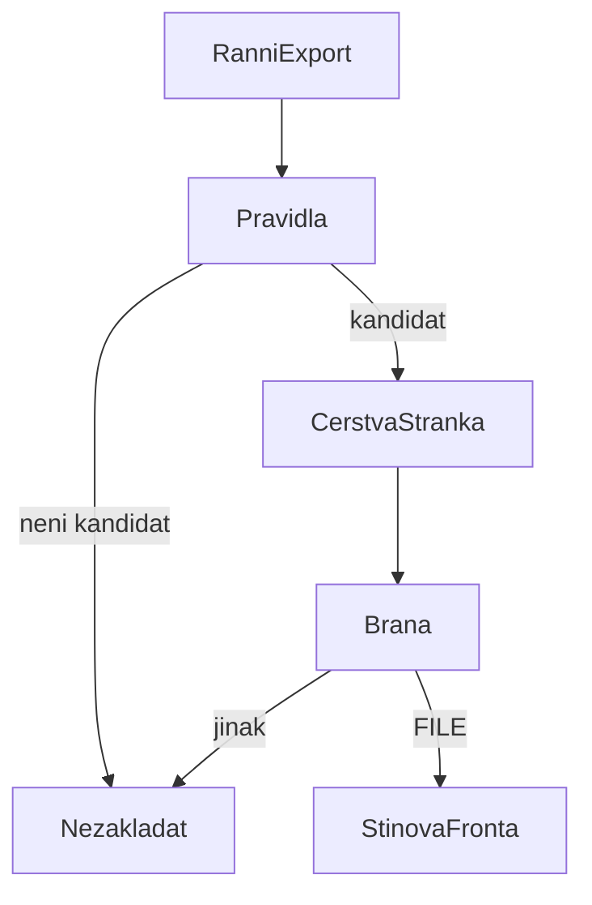

# Návrh: ranní založení reklamace

## Proč kandidát vzniká a kde je pravda o doručení

Kandidát vzniká proto, že normalizovaný stav v Mailshipu zestárnul. Objednávka pořád sedí v `čeká na dopravce` (aspoň 2 dny) nebo v `převzato dopravcem` (aspoň 14 dní), a projde vyloučením dopravy, druhou reklamací a vratkou. Ten stav je důvod, proč se řádek objeví v ranním reportu. Není to důkaz, že zásilka nedorazila.

Pravda o doručení je čerstvá stránka dopravce po retracku. Referent ji dnes otevírá právě proto, že zásilka mezitím často dorazila. `decide` proto umí jen říct „je to kandidát, a co ho blokuje“. `gate` čte až výsledek stránky. Souhlas stránky se stavem v Mailshipu se nevyžaduje. Stav jen otevírá dveře.

## Pravidla vs. model

Pravidla drží všechno, co je v souborech: stav, okno, vyloučenou dopravu, existující reklamaci včetně konceptu, vratku včetně stavu Připraveno a reportéra. Založení je mechanické. Model na tomhle místě by byl chyba, protože by z pevné podmínky udělal odhad.

Jediný nestrukturovaný vstup je HTML dopravce. Stránky mají čtyři šablony, takže je čte deterministický čtenář, jedna šablona na dopravce. Stojí 0 Kč na stránku, běží offline a na stejné HTML vrátí stejný výsledek. Když šablonu nepozná, řekne `nevím`. Brána z toho udělá práci pro člověka, ne reklamaci.

Model by měl místo až u dlouhého chvostu dopravců bez šablony. Spouštěč: podíl `nevím` s příčinou `unrecognized_template` přes dohodnutý práh (v README zatím 10 %), měřený na holdoutu. Model by klasifikoval jen do čtyř stavů, nízká jistota by zůstala `nevím`. Odhad ceny je v README a `src/tracking/llm.ts`; na hot path se model nevolá.

Na 64 syntetických stránkách je shoda holdoutu 93.1 %, dev 94.3 %. Nebezpečných čtení je 0, potlačujících 0, zdrženlivých 4. Všechna čtyři jsou šablona v2 u Rychlopostu: člověk stav přečte, čtečka se zdrží.

## Ověření doručení

| Pravidla | Stránka | Akce |
|---|---|---|
| kandidát B | v přepravě | založit, ztráta |
| kandidát A | nevím, dopravce zásilku zná a nemá sken | založit, nevyzvednuto |
| kandidát A | v přepravě | nezakládat, Mailship je zastaralý |
| kandidát | doručeno nebo vrací se | nezakládat |
| kandidát B, nebo A s jiným nevím | nevím | člověk |
| kandidát | stránka chybí | člověk |
| není kandidát | — | nezakládat, kód pravidel |

Když se čtení splete směrem „v přepravě“ u zásilky, která už je doručená, vznikne falešná ztráta. Tomu se brání zdrženlivost: neznámé znění a neznámá šablona jsou `nevím`, a `nevím` u ztráty nezakládá. Když se splete směrem „doručeno“, ztráta se ten den nepodá. Nic se tím nezapisuje natrvalo. Ráno se počítá znovu.

Když stránka není k dispozici, reklamace se nezaloží. Chybějící stránka není důkaz.

`no_carrier_events` zakládá jen nevyzvednutí. U ztráty prázdná historie nedokazuje, že zásilka nedorazila.

## Nasazení bez škody

První týdny běží stín. Lidé zakládají dál. Job jen vypíše, co by založil, a proč by nezaložil. V řezu to umí `npm run reconcile` proti souboru reklamací; naostro by proti sobě šly akce člověka z daného dne. Úspěch znamená přesnost řádků `FILE` proti rozhodnutí člověka, nula stínových `FILE` u zásilky, kterou člověk našel jako doručenou, a udržený podíl `NEEDS_HUMAN`. Do Mailshipu se nezapisuje.

Naostro se přepne až po týdnu, ve kterém ta nula platí a přesnost `FILE` je domluvená s reklamačním oddělením. Vypínač je jeden příznak jobu. Špatné „doručeno“ objednávku nevyřadí navždy, protože se nic neukládá.

## Ranní běh

