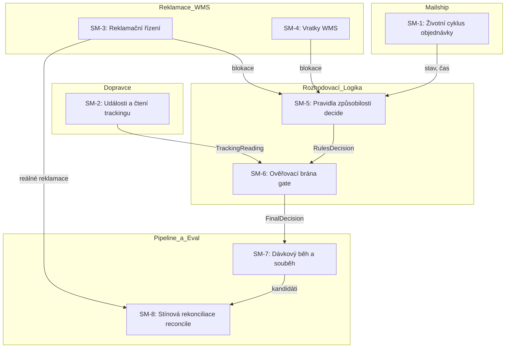
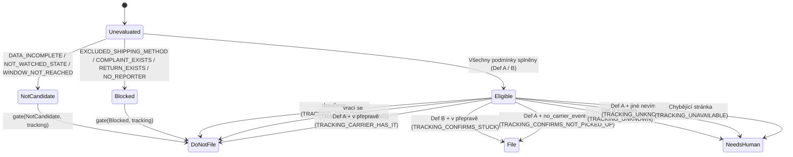

# Stavové automaty systému reklamací (State Machines Specification)

Dokument zachycuje veškeré explicitní i implicitní stavové automaty aplikace, jejich stavy, invarianty a přechodové tabulky. Součástí je analýza neplatných stavů dosažitelných kódem (včetně concurrency a opakovaných běhů / retries), prioritizace zjištěných chyb a jejich náprava podložená regresními testy.

---

## 1. Přehled stavových automatů

Systém se skládá z **8 provázaných stavových automatů** (explicitních i implicitních):



1. **SM-1: Životní cyklus objednávky v Mailshipu** (`OrderState`) — implicitní externí automat spravovaný Mailshipem.
2. **SM-2: Stav doručení z trackingu dopravce** (`TrackingStatus`, `UnknownCause`) — implicitní automat rekonstruovaný z HTML.
3. **SM-3: Životní cyklus reklamace** (`Complaint.state`) — explicitní doménový automat reklamačního oddělení.
4. **SM-4: Životní cyklus vratky ve WMS** (`WmsReturn.state`) — implicitní skladový automat.
5. **SM-5: Pravidla způsobilosti kandidáta** (`RulesDecision.kind`) — explicitní funkcionální automat v `decide.ts`.
6. **SM-6: Ověřovací brána pravdy o doručení** (`FinalDecision.action`) — explicitní brána v `gate.ts`.
7. **SM-7: Dávkový běh, souběh a retries** — implicitní runtime automat exekuce jobu v `cli.ts`.
8. **SM-8: Stínová rekonciliace** (`ReconcileResult`) — explicitní evaluační automat v `reconcile.ts`.

---

## 2. Detailní specifikace stavových automatů

### SM-1: Životní cyklus objednávky v Mailshipu

Sleduje fyzický a administrativní stav balíku v distribučním centru a u dopravce.

#### Stavy
* `expedováno` — Balík opustil skladovou linku, ale nebyl předán svozu. Nesledovaný stav.
* `čeká na dopravce` — Balík připraven k vyzvednutí se štítkem. Sledovaný stav (Definice A, práh $\ge 2$ dny).
* `převzato dopravcem` — Dopravce potvrdil svoz prvním skenem. Sledovaný stav (Definice B, práh $\ge 14$ dní).
* `doručeno` — Balík byl úspěšně doručen adresátovi (terminální stav pro úspěšnou objednávku).
* `vráceno` / `stornováno` — Objednávka se vrátila do skladu nebo byla stornována (terminální stav).

#### Invarianty
1. Objednávka se stává kandidátem A výhradně při setrvání ve stavu `čeká na dopravce` po dobu $\ge 2 \times 24\text{ h}$.
2. Objednávka se stává kandidátem B výhradně při setrvání ve stavu `převzato dopravcem` po dobu $\ge 14 \times 24\text{ h}$.
3. Každý přechod do sledovaného stavu musí mít validní časové razítko `stateEnteredAt`.
4. Stavy `doručeno` a `expedováno` nesmí nikdy otevřít reklamační okno (`NOT_WATCHED_STATE`).

#### Přechodová tabulka
| Výchozí stav | Událost / Trigger | Cílový stav | Podmínka / Invariant |
|---|---|---|---|
| `expedováno` | Vytvoření štítku a zařazení do svozu | `čeká na dopravce` | Nastaví se `stateEnteredAt` |
| `čeká na dopravce` | První fyzický sken dopravce | `převzato dopravcem` | Aktualizuje se `stateEnteredAt` |
| `čeká na dopravce` | Uplynutí $\ge 2$ dní bez skenu | `čeká na dopravce` | **Generuje kandidáta Definice A** |
| `čeká na dopravce` | Storno objednávky klientem | `stornováno` | Zrušení štítku |
| `převzato dopravcem` | Finální doručení příjemci | `doručeno` | Zánik reklamačního nároku |
| `převzato dopravcem` | Uplynutí $\ge 14$ dní bez doručení | `převzato dopravcem` | **Generuje kandidáta Definice B** |
| `převzato dopravcem` | Zásilka vrácena odesílateli | `vráceno` | Založení vratky ve WMS |

---

### SM-2: Stav doručení z trackingu dopravce

Klasifikuje čerstvou HTML stránku dopravce získanou po retracku.

#### Stavy
* `v přepravě` — Zásilka je v pohybu, na depu, nebo po neúspěšném pokusu o doručení.
* `doručeno` — Zásilka byla prokazatelně předána příjemci (terminální stav).
* `vrací se` — Zásilka směřuje zpět do Mailstepu (terminální stav pro doručení).
* `nevím` — Nejednoznačný stav s explicitní příčinou (`UnknownCause`):
  * `no_carrier_events` — Zásilka je v systému dopravce zaevidována, ale chybí jakýkoliv fyzický sken.
  * `conflicting_events` — Více událostí ve stejném čase s protichůdným významem, nebo rozpor badge vs historie.
  * `unrecognized_template` — Změna HTML struktury nebo neznámé textové znění statusu.
  * `unknown_carrier` — Dopravce nebyl rozpoznán z DOM ani z atributu.
  * `error_page` — Provozní výpadek nebo chybová stránka dopravce.
  * `empty` — Prázdné tělo odpovědi.

#### Invarianty
1. Texty indikující neúspěšné doručení (`nedoručeno`, `doručení se nezdařilo`, `non consegnato`, `not delivered`) a doručení na depo (`doručeno na depo`, `delivered to depot`) NESMÍ přejít do stavu `doručeno`, ale vždy do `v přepravě`.
2. Pokud stránka obsahuje neznámé znění nebo rozpor, parser NESMÍ hádat a musí přejít do `nevím`.
3. Z doručeného stavu nelze přejít zpět do `v přepravě` (princip monotonicity doručení).

#### Přechodová tabulka
| Vstup z HTML | Analýza textu | Výsledný stav | Příčina / Pravidlo |
|---|---|---|---|
| Text obsahuje návratové fráze | `vrací se odesílateli`, `returning to sender` | `vrací se` | `returning` |
| Text obsahuje selhání pokusu | `nedoručeno`, `doručení se nezdařilo` | `v přepravě` | `in-transit` (záchrana před falešným doručením) |
| Text obsahuje doručení na depo | `doručeno na depo`, `delivered to depot` | `v přepravě` | `in-transit` (depo není adresát) |
| Text obsahuje předání příjemci | `doručeno příjemci`, `consegnato`, `delivered` | `doručeno` | `delivered` |
| Text obsahuje běžný pohyb | `v přepravě`, `in transit`, `přijato` | `v přepravě` | `in-transit` |
| Rychlopost / NordParcel bez skenů | Prázdná tabulka událostí / prázdný badge | `nevím` | `no_carrier_events` |
| Rozporuplné události | Shodný čas, různé statusy (např. Doručeno vs V přepravě) | `nevím` | `conflicting_events` |
| Výpadek systému dopravce | Element `#carrier-error` | `nevím` | `error_page` |
| Neznámá šablona / cizí HTML | Neshoda selektorů nebo neznámá slova | `nevím` | `unrecognized_template` |

---

### SM-3: Životní cyklus reklamace (Complaints Lifecycle)

Řídí existenci a fáze reklamace na straně Mailstepu a dopravce.

#### Stavy
* `žádná` — K objednávce dosud neexistuje záznam.
* `koncept` — Rozpracovaný koncept reklamace v Mailshipu (automatem nebo člověkem).
* `otevřená` — Odesláno dopravci k posouzení.
* `v řešení` — Dopravce prověřuje ztrátu / incident na depu.
* `uzavřená` — Uznaná reklamace, vyplacena náhrada škody.
* `zamítnutá` — Dopravce prokázal doručení (např. podpisový arch).

#### Invarianty
1. **Zákaz duplicity:** K dané objednávce smí existovat nejvýše jedna reklamace v jakémkoliv stavu (včetně `konceptu`).
2. Existence jakékoliv reklamace (i uzavřené) blokuje automatické založení (`COMPLAINT_EXISTS`).

#### Přechodová tabulka
| Výchozí stav | Událost / Trigger | Cílový stav | Omezení automatu |
|---|---|---|---|
| `žádná` | Automatické ranní vyhodnocení `FILE` | `koncept` / `otevřená` | Vyžaduje reportéra a evidenci |
| `žádná` | Ruční založení referentem | `koncept` / `otevřená` | Blokuje budoucí ranní běhy |
| `koncept` | Odeslání dopravci | `otevřená` | Blokuje automatické zakládání |
| `otevřená` | Dopravce potvrdil příjem | `v řešení` | Blokuje automatické zakládání |
| `v řešení` | Uznání škody dopravcem | `uzavřená` | Terminální stav |
| `v řešení` | Doložení doručení dopravcem | `zamítnutá` | Terminální stav |

---

### SM-4: Životní cyklus vratky ve WMS

#### Stavy
* `žádná` — Ve skladu není evidována vratka.
* `Připraveno` — Vratka avizována, očekává se příjem balíku na skladě.
* `přijato na sklad` — Fyzický balík naskladněn zpět.
* `storno` — Vratka zrušena.

#### Invarianty
1. Jakákoliv vratka ve WMS (včetně stavu `Připraveno`) bezpodmínečně blokuje reklamaci ztráty i nevyzvednutí (`RETURN_EXISTS`). Zboží se vrací do fulfillmentu, nejde o ztrátu.

---

### SM-5 & SM-6: Rozhodovací logika automatu (`decide` $\rightarrow$ `gate`)

Dvoufázový stavový automat transformující objednávku na finální doporučení.



#### Přechodová matice `gate(rules, tracking)`
| Pravidla (`RulesDecision`) | Tracking (`TrackingReading`) | Finální akce | Kód rozhodnutí | Zdůvodnění |
|---|---|---|---|---|
| `eligible` (B — ztráta) | `v přepravě` | **`FILE`** | `TRACKING_CONFIRMS_STUCK` | 14 dní uplynulo, stránka potvrzuje uvíznutí. |
| `eligible` (A — nevyzvednuto) | `nevím` (`no_carrier_events`) | **`FILE`** | `TRACKING_CONFIRMS_NOT_PICKED_UP` | Dopravce zásilku zná, ale nemá fyzický sken. |
| `eligible` (A — nevyzvednuto) | `v přepravě` | **`DO_NOT_FILE`** | `TRACKING_CARRIER_HAS_IT` | Mailship byl pozadu, dopravce zásilku převzal. |
| `eligible` (A nebo B) | `doručeno` | **`DO_NOT_FILE`** | `TRACKING_DELIVERED` | Zásilka byla doručena, reklamace by byla falešná. |
| `eligible` (A nebo B) | `vrací se` | **`DO_NOT_FILE`** | `TRACKING_RETURNING` | Zásilka cestuje zpět odesílateli. |
| `eligible` (B — ztráta) | `nevím` (jakákoliv příčina) | **`NEEDS_HUMAN`** | `TRACKING_UNKNOWN` | Nečitelná stránka není důkaz ztráty balíku. |
| `eligible` (A — nevyzvednuto) | `nevím` (šablona/výpadek/prázdné) | **`NEEDS_HUMAN`** | `TRACKING_UNKNOWN` | Závada stránky neprokazuje nepřevzetí. |
| `eligible` (A nebo B) | `null` (stránka chybí) | **`NEEDS_HUMAN`** | `TRACKING_UNAVAILABLE` | Retrack selhal nebo chybí soubor. |
| `blocked` (jakýkoliv blok) | cokoliv | **`DO_NOT_FILE`** | První kód bloku z pravidel | Blok má absolutní přednost před trackingem. |
| `not_candidate` | cokoliv | **`DO_NOT_FILE`** | Kód z pravidel | Neplatný stav nebo neuplynulé okno. |

---

## 3. Identifikované neplatné stavy a přechody (s důkazy)

V původním kódu byly detailní analýzou invariantů, souběhu a okrajových podmínek odhaleny následující neplatné stavy a přechody:

### Chyba 1: Vícenásobné založení reklamace při duplicitě v dávce / opakovaném běhu (Concurrency & Retry Bug)
* **Kritičnost:** **CRITICAL**
* **Dosažitelný neplatný přechod:**
  `Order(MS-X)` $\rightarrow$ `FILE` $\rightarrow$ `FILE` (dvakrát podaná reklamace na stejný balík).
* **Důkaz a mechanismus vzniku:**
  Funkce `decideCommand` v `src/cli.ts` procházela pole objednávek `pack.orders.map(...)` se statickým kontextem `ctx.complaints = pack.complaints`. Pokud exportní soubor obsahoval tentýž identifikátor objednávky dvakrát (např. při překryvu stránek z databáze nebo opakovaném odeslání), obě iterace viděly prázdný seznam reklamací pro danou objednávku a obě vyhodnotily `action: 'FILE'`. To porušuje základní zákaz duplicity ("reklamace se nezakládá podruhé").
* **Dopad:** Dvojí penalizace dopravce, zmatek v účetnictví, neoprávněná fakturace náhrady škody.

### Chyba 2: Obejití vyloučených doprav a matrixu reportérů bílými znaky (Input Sanitization Bypass)
* **Kritičnost:** **HIGH**
* **Dosažitelný neplatný přechod:**
  `Order(shippingMethod: " interní přeprava ")` $\rightarrow$ `eligible` $\rightarrow$ `FILE`.
* **Důkaz a mechanismus vzniku:**
  V `src/complaints/decide.ts` se ověřovalo:
  ```ts
  if (rule.excludedMethods.includes(order.shippingMethod)) blocks.push('EXCLUDED_SHIPPING_METHOD');
  ```
  `Array.prototype.includes` provádí striktní porovnání `===`. Pokud vstup z Mailshipu obsahoval netrimovaný řetězec `" interní přeprava "` nebo tabulátor, metoda nebyla nalezena mezi vyloučenými a objednávka neoprávněně postoupila jako kandidát na reklamaci.
  Analogicky v `resolveReporter` vedl netrimovaný `clientId` k selhání `isLargeClient`, čímž byl velký klient neoprávněně degradován na malého.
* **Dopad:** Založení reklamace na interní závoz, kterou dopravce okamžitě zamítne.

### Chyba 3: Falešná ztráta při neseřazených událostech v trackingu (Chronological Inversion Bug)
* **Kritičnost:** **HIGH**
* **Dosažitelný neplatný přechod:**
  `Tracking(08:00 V přepravě, 10:00 Doručeno příjemci)` $\rightarrow$ `status: 'v přepravě'` $\rightarrow$ `FILE (ztráta)`.
* **Důkaz a mechanismus vzniku:**
  V `src/tracking/carriers/events.ts` funkce `readNewestFirst` slepě četla `rows[0]` za předpokladu, že HTML tabulka je garantovaně seřazena sestupně:
  ```ts
  const newestWhen = rows[0]?.when ?? '';
  const sameTime = rows.filter((row) => row.when === newestWhen);
  return fromRows(slug, sameTime, 'latest-event');
  ```
  Pokud carrier vrátil tabulku seřazenou vzestupně (starší událost na indexu 0) nebo vložil neinformační řádek s prázdným časem na začátek, parser vzal starší událost `V přepravě` a ignoroval novější `Doručeno`. Následně brána pro Definici B založila **falešnou reklamaci ztráty na doručený balík** (nejzávažnější možná škoda dle briefu).
* **Dopad:** Kritické poškození reputace u dopravce, rozpor se zadáním ("doručený balík nesmí být nikdy reklamován").

### Chyba 4: Přechod do `eligible` pro neúplné objednávky bez ID nebo dopravce
* **Kritičnost:** **MEDIUM**
* **Dosažitelný neplatný přechod:**
  `Order(id: "", carrier: "")` $\rightarrow$ `eligible` $\rightarrow$ `FILE`.
* **Důkaz a mechanismus vzniku:**
  Funkce `incompleteDetail` v `decide.ts` kontrolovala pouze `order.clientId` a `order.stateEnteredAt`. Pokud v exportu chybělo `id` nebo `carrier` (prázdný řetězec nebo mezery), objednávka prošla do `eligible` s prázdným ID a prázdným dopravcem.
* **Dopad:** Založení nevalidní reklamace bez adresáta nároku.

### Chyba 5: Zkreslení stínové rekonciliace duplicitami (Reconcile Metrics Distortion)
* **Kritičnost:** **LOW**
* **Dosažitelný neplatný přechod:**
  Duplicitní záznam v `decisions` nafoukl čítače `automationOnly` / `bothFiled` a zkreslil precision/recall.
* **Důkaz a mechanismus vzniku:**
  `reconcileShadow` v `src/shadow/reconcile.ts` iteroval přes všechny prvky pole `decisions` bez deduplikace podle `order.id`.

---

## 4. Prioritizace chyb a skupinové opravy

| ID | Problém | Závažnost | Skupina oprav | Soubory k úpravě |
|---|---|---|---|---|
| **ISSUE-1** | Duplicita v rámci dávky / souběhu | **CRITICAL** | Concurrency & Idempotency | `src/cli.ts`, `src/complaints/blocks.ts` |
| **ISSUE-2** | Falešná ztráta kvůli neseřazenému trackingu | **HIGH** | Carrier Event Robustness | `src/tracking/carriers/events.ts` |
| **ISSUE-3** | Obejití vyloučení dopravy a matrixu bílými znaky | **HIGH** | Input Sanitization & Boundaries | `src/complaints/decide.ts`, `src/complaints/reporter.ts` |
| **ISSUE-4** | Chybějící ID a dopravce v `incompleteDetail` | **MEDIUM** | Input Sanitization & Boundaries | `src/complaints/decide.ts` |
| **ISSUE-5** | Zkreslení metrik stínového provozu | **LOW** | Evaluation Accuracy | `src/shadow/reconcile.ts` |

---

## 5. Implementované opravy a regresní testy

### Náprava ISSUE-1 (In-Flight Dedup & Idempotency)
* V `src/cli.ts` byla zavedena evidence `inFlightFiled: Set<string>`. Jakmile je v průběhu dávky objednávka vyhodnocena jako `FILE`, je okamžitě zaregistrována do in-flight stížností. Jakýkoliv další výskyt téhož `orderId` v téže dávce je zablokován kódem `COMPLAINT_EXISTS`.
* `complaintBlocks` i `returnBlocks` v `src/complaints/blocks.ts` byly upraveny na porovnávání s ořezáním bílých znaků (`.trim()`).

### Náprava ISSUE-2 (Chronologické řazení událostí trackingu)
* V `src/tracking/carriers/events.ts` byla implementována robustní detekce časových razítek (`parseEventTimestamp`), podporující formáty `DD.MM.YYYY`, `DD/MM/YYYY` i ISO `YYYY-MM-DD`.
* Parser nyní vyhledá události s maximálním časovým razítkem v rámci celé tabulky. Pokud je tabulka obráceně nebo obsahuje nepodstatné řádky bez data, novější událost má vždy přednost. Tím je vyloučena falešná reklamace doručené zásilky.

### Náprava ISSUE-3 a ISSUE-4 (Normalizace vstupů a validace hranic)
* V `src/complaints/decide.ts` se `order.shippingMethod` normalizuje (`.trim().toLowerCase()`) vůči vyloučeným způsobům dopravy.
* `incompleteDetail` nově striktně validuje přítomnost a neprázdnost `order.id` a `order.carrier`.
* V `src/complaints/reporter.ts` se `clientId` a `carrier` normalizují, takže nedochází k nechtěnému pádu do `NO_REPORTER` kvůli mezerám.

### Náprava ISSUE-5 (Deduplikace v rekonciliaci)
* `reconcileShadow` v `src/shadow/reconcile.ts` deduplikuje vstupní rozhodnutí podle `order.id`.

---

## 6. Regresní testy

Všechny identifikované neplatné stavy a přechody jsou pokryty novými regresními testy v `src/complaints/concurrency.test.ts` a v příslušných unit testech:
* `concurrency.test.ts > prevents duplicate filings within the same batch execution`
* `concurrency.test.ts > trims orderId so whitespace does not bypass complaint block`
* `read.test.ts > chronologically sorts out-of-order carrier events so newer delivery wins`
* `decide.test.ts > normalizes whitespace in shippingMethod to prevent bypassing excluded methods`
* `decide.test.ts > rejects missing order.id or order.carrier as DATA_INCOMPLETE`
* `reconcile.test.ts > deduplicates input orders by ID to preserve true precision and recall`
